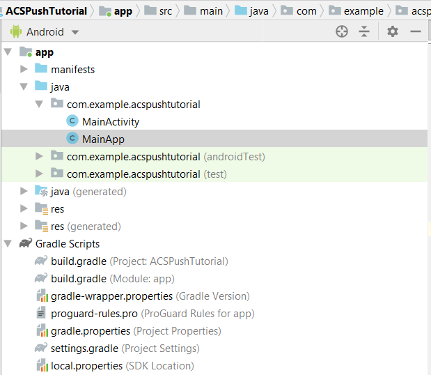

# 手順2 - [!UICONTROL Mobile SDK]とAndroid アプリの統合

このパートでは、[!DNL Android] アプリを[!UICONTROL Mobile SDK]と統合します。 [!UICONTROL mobile SDK]を[!DNL Android] アプリと統合するには、次の手順に従ってください。

* [!DNL Android Studio]で&#x200B;*ACSPushTutorial* プロジェクトを開く
* [!DNL android.app.Application]を拡張する&#x200B;*MainApp*&#x200B;という新しいJava クラスを作成します
* 現在のプロジェクト構造は次のようになります



* [!DNL Gradle Scripts] フォルダーを展開します。 モジュールの[!DNL build.gradle]をダブルクリックします。 次の依存関係を[!DNL build.gradle] ファイルの依存関係セクションにに貼り付けます。 [!DNL build.gradle] ファイルは次のようになります

<!--
Removed `{.line-numbers}` below
-->

```java
implementation 'com.adobe.marketing.mobile:campaign:1.+'
implementation 'com.adobe.marketing.mobile:userprofile:1.+'
implementation 'com.adobe.marketing.mobile:sdk-core:1.+'
```


* 「今すぐ同期」ボタンをクリックしてプロジェクトを同期し、[!DNL Android] プロジェクトを同期します

## [!DNL AndroidManifest.xml]を変更{#modify-android-manifest}

*AndroidManifest.xml*&#x200B;を開き、マニフェスト要素の後とアプリケーション要素の前に次の2行を貼り付けます。 これにより、アプリは外部の世界と通信できるようになります

<!--
Removed `{.line-numbers}` below
-->

```xml
<uses-permission android:name="android.permission.INTERNET" />
<uses-permission android:name="android.permission.ACCESS_NETWORK_STATE" />
```

アプリケーション要素に次の行をコピーします
[!DNL android:name=&quot;.MainApp&quot;]
を保存 [!DNL AndroidManifest.xml]
[!DNL AndroidManifest.xml]は次のようになります

<!--
Removed `{.line-numbers}` below
-->

```xml
<?xml version="1.0" encoding="utf-8"?>
<manifest xmlns:android="http://schemas.android.com/apk/res/android"
    package="com.example.acspushtutorial">
    <uses-permission android:name="android.permission.INTERNET" />
    <uses-permission android:name="android.permission.ACCESS_NETWORK_STATE" />

<application
    android:name=".MainApp"
    android:allowBackup="true"
    android:icon="@mipmap/ic_launcher"
    android:label="@string/app_name"
    android:roundIcon="@mipmap/ic_launcher_round"
    android:supportsRtl="true"
    android:theme="@style/AppTheme">

<activity android:name=".MainActivity">
<intent-filter>
    <action android:name="android.intent.action.MAIN" />
    <category android:name="android.intent.category.LAUNCHER" />
</intent-filter>
</activity>
</application>

</manifest>
```
